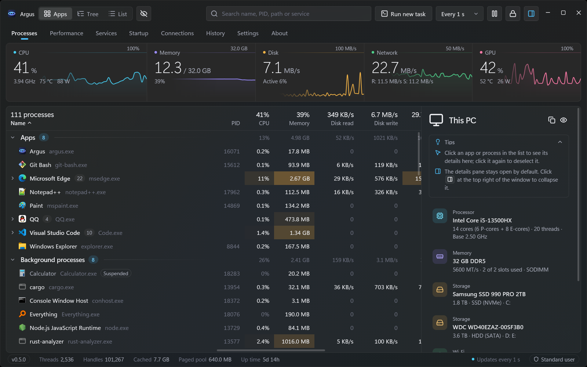
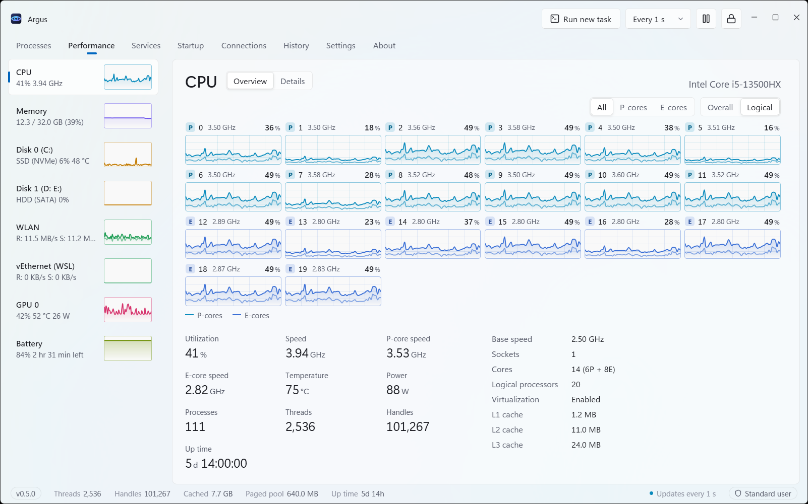

# Argus

Argus is an open-source Windows task manager built with Rust and GPUI Kit. It brings process management, hardware monitoring and resource usage history into a native desktop interface with continuously scrolling charts.

## Understand what is running

Browse running software by application, process tree or flat list. Compare CPU, memory, disk, network and GPU activity, search for a process, and inspect its details. Resource heatmaps help identify busy applications, while process controls include ending a process tree, changing priority and enabling efficiency mode. Rules can apply priority and efficiency settings whenever a program starts.

## Explore system performance

Dedicated views cover CPU, memory, disks, network adapters, GPUs and batteries. CPU charts separate logical processors and distinguish performance and efficiency cores. Disk views include health and SMART information, while supported hardware can expose temperature and power readings through optional sensors.

## Investigate slowdowns and file locks

Review up to seven days of recorded resource usage and select a point in time to inspect the busiest processes. Drop a file or folder onto the window to find processes holding it open. Inspect TCP and UDP endpoints alongside their owning processes, manage Windows services, and control startup applications.

## Fit into the Windows desktop

Argus supports light and dark themes, the Windows accent color and a Mica backdrop on Windows 11 22H2 and later. A tray icon and configurable global shortcut keep monitoring close at hand. The interface is available in English, Simplified Chinese, Traditional Chinese, Spanish, German, Japanese, French and Russian.

Argus supports Windows 10 22H2 and later on x64 systems with DirectX 11 graphics. It is released under AGPL-3.0-or-later.

[Official website](https://argustask.com/en/) · [Source code](https://github.com/Ray-lea/Argus)
