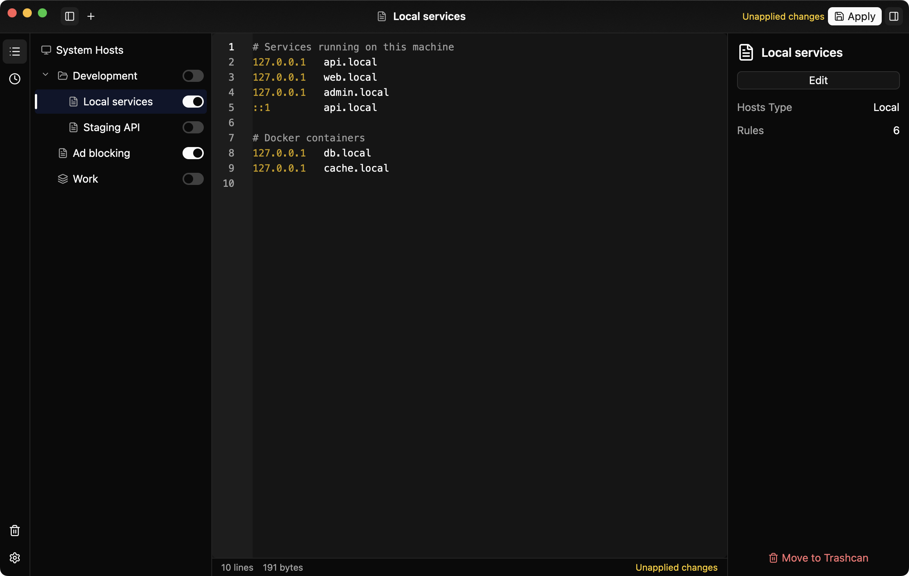

# SwitchHosts Lite

SwitchHosts Lite is a lightweight take on SwitchHosts: a native desktop app for managing and switching the system hosts file. It is written in Rust with GPUI Kit and ships as a single executable for macOS, Windows and Linux, with no Electron or WebView. It keeps the core SwitchHosts workflow of splitting hosts rules into entries, switching them on and off, and writing the result to the system hosts file.

## Entries

Rules are organized as three kinds of entries. A local entry is a piece of hosts text edited in place. A folder can be nested and has a choice mode: multiple, single (only one child enabled at a time), or the default that follows the top-level setting. A group references local entries and combines their content in the chosen order. Entries, folders and groups can be reordered and regrouped by drag and drop, as in SwitchHosts.

## Switching and applying

Turning an entry on or off writes the system hosts file right away, asking for an administrator password, UAC or polkit authorization only when the current user cannot write the file. If writing fails, the switch reverts. While a local entry is edited, its content is applied about a second after typing stops whenever no password is needed; otherwise the status bar shows that changes are unapplied.

The app only maintains its own marked block at the end of the hosts file, so lines written by hand or by other tools stay untouched. The first row of the list is a read-only view of the current system hosts, re-read when the window regains focus.

## History, trash and backups

Every write that changes the system hosts records the content before and after it, and any version can be viewed or restored. Deleted entries go to the trash first and can be restored to their original folder. SwitchHosts v3, v4 and v5 backups can be imported, and data can be exported in a format that SwitchHosts v4 and v5 import.

## Editing

The editor highlights comments, IP addresses and lines whose first field is not a valid IP address. Shortcuts toggle comments and move, duplicate or delete lines.

## Look and language

The interface follows the system light or dark mode, with 36 bundled color themes chosen separately for each mode, plus custom theme files. It is available in English, Simplified Chinese and Traditional Chinese, following the system language by default. Updates are checked on GitHub Releases, verified and installed in place.
